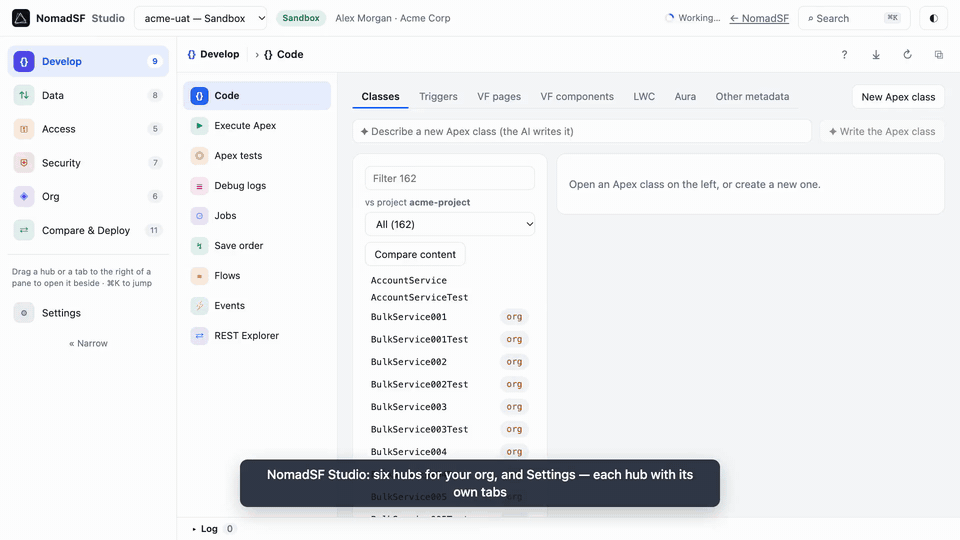
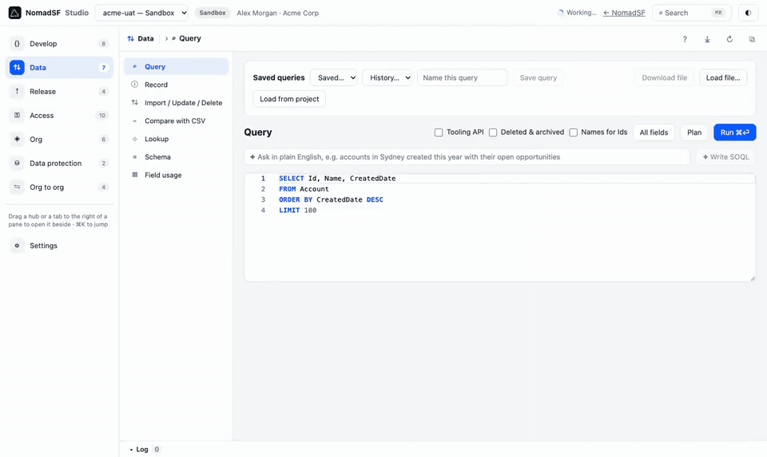
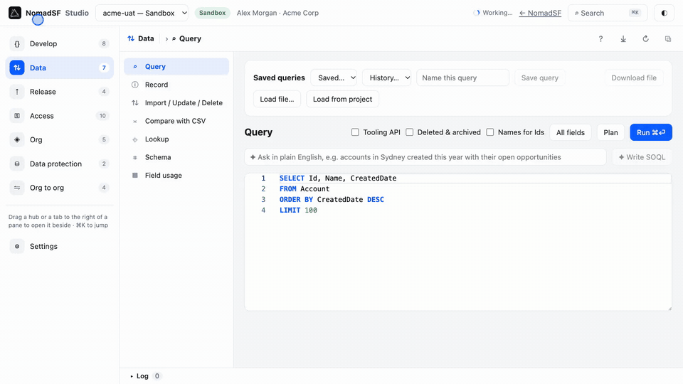
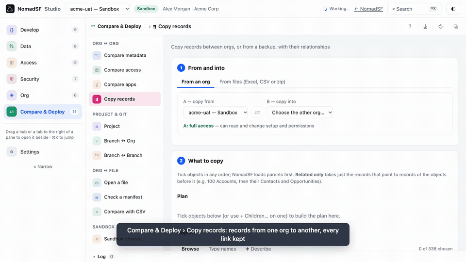

# NomadSF

**A Salesforce workbench in your browser** — Execute Apex, SOQL, code, debug logs, metadata and org compare, plus data backup, restore, migration and lifecycle jobs. It uses the Salesforce login you already have in Chrome or Edge: no CLI, nothing to install on the org, nothing sent anywhere but Salesforce.

[](https://github.com/faridmasjedi/plugin-fm/releases/latest) [](https://github.com/faridmasjedi/plugin-fm/actions/workflows/ci.yml) [](LICENSE.txt)

**[📖 Website and guide](https://faridmasjedi.github.io/plugin-fm/)** · **[⬇ Download](https://faridmasjedi.github.io/plugin-fm/#download)** · [Releases](https://github.com/faridmasjedi/plugin-fm/releases)



▶ **[The guide](https://faridmasjedi.github.io/plugin-fm/guide.html)**: a video with subtitles for every hub and every tab.

## What's inside

Tools are grouped into hubs, each with its own sidebar of tools. Open two or three side by side (drag a hub or a tool to the right of a pane), jump anywhere with <kbd>⌘K</kbd> (a tool's name, or what you want to do: "stop a batch job"), and every tab keeps its results until you reset it.



| Hub                  | Tools                                                                                                                                                                                                                                                                                                                                                                                                                                  |
| -------------------- | -------------------------------------------------------------------------------------------------------------------------------------------------------------------------------------------------------------------------------------------------------------------------------------------------------------------------------------------------------------------------------------------------------------------------------------- |
| **Develop**          | Code (Apex, triggers, Visualforce, LWC, Aura — with dependencies and a compare with your repository) · Execute Apex (with help) · Apex tests with coverage · Code checks (security mistakes in code) · Debug logs (with insights) · Jobs · Save order (what runs on save) · Flows (old versions, old API versions, waiting and failed interviews) · Platform events and CDC · REST Explorer                                            |
| **Data**             | Query (SOQL with help and autocomplete, saved queries, Bulk export) · Record (every field, history, the related tree to copy or save as Excel) · Import / Update / Delete · Lookup · Custom settings · Schema · Field usage · Backup to your own folder and Restore · Lifecycle jobs with approval                                                                                                                                     |
| **Access**           | Users (everything a user has; snapshots and workbooks) · Access sets (profiles, permission sets, groups, custom permissions: what each allows, who has it, assign) · Groups & queues · Assign in bulk (to or from many users) · Object access · Compare                                                                                                                                                                                |
| **Security**         | Dashboard · Timeline (everything that happened) · Event logs · Who can see a record, object, field or class, and why · Integration check (why an integration fails) · Sharing (as a tree) · Org health · Logins & audit                                                                                                                                                                                                                |
| **Org**              | Company · Limits and storage · Licenses (and who holds one without using it) · Connected apps and OAuth usage · Apps & credentials (every setting of connected apps, external client apps and named credentials, to change) · Metadata · Deployments                                                                                                                                                                                   |
| **Compare & Deploy** | Everything between two places: Org ↔ Org (compare metadata and deploy, compare access and apps, copy records keeping every link) · Project & git (the project against the org: compare, retrieve, deploy; a branch against the org; two branches as package.xml and destructiveChanges.xml) · Org ↔ File (open a snapshot, workbook or CSV; check a package.xml against an org; compare with CSV) · Sandbox refresh (before and after) |
| **✦ AI**             | Your own provider (Claude, OpenAI, Gemini, OpenRouter, Ollama, any endpoint) writes SOQL, Apex and new metadata, changes a component from a sentence, explains logs and failures, reviews code                                                                                                                                                                                                                                         |



## Get it

| What                                 | How                                                                                                                                                                                                                                    |
| ------------------------------------ | -------------------------------------------------------------------------------------------------------------------------------------------------------------------------------------------------------------------------------------- |
| **Browser extension** (Chrome, Edge) | Download [`nomadsf-extension.zip`](https://github.com/faridmasjedi/plugin-fm/releases/latest/download/nomadsf-extension.zip), unzip, `chrome://extensions` → Developer mode → **Load unpacked**. Store listings are on the way.        |
| **VS Code**                          | Download [`nomadsf-vscode.vsix`](https://github.com/faridmasjedi/plugin-fm/releases/latest/download/nomadsf-vscode.vsix) → Extensions → **Install from VSIX…** (works on its own; uses the Salesforce CLI's logins or logs in itself). |
| **One version**                      | Each release ships the plugin, the browser extension and the VS Code extension with the same version number.                                                                                                                           |
| **Every version**                    | [GitHub Releases](https://github.com/faridmasjedi/plugin-fm/releases), or the list on the [website](https://faridmasjedi.github.io/plugin-fm/#download).                                                                               |

Then open any Salesforce page and click the NomadSF icon, or the **N** tab on the right edge (<kbd>Alt</kbd>+<kbd>Shift</kbd>+<kbd>N</kbd>). The [guide](https://faridmasjedi.github.io/plugin-fm/guide.html) walks through every hub.



## Safety and privacy

- **Your login, not ours** — the extension calls Salesforce with your browser session; it stores no password or token and has no server.
- **Every change asks first** — saving code, editing records, deploying, deleting, restoring and copying data ask you to type the org name; production orgs are shown in red.
- **Your data stays with you** — backups go to a folder you choose on your own computer, optionally encrypted (AES-256) with your passphrase.
- **AI only suggests** — it fills editors or shows text; nothing runs until you press the usual button. Keys stay in the extension and go only to the provider you chose.

Details: [nomadsf/STUDIO.md](nomadsf/STUDIO.md).

## For developers and CI: the `sf fm` plugin

This repository also ships a Salesforce CLI plugin for release pipelines, and the local app it runs (`sf fm dashboard`). NomadSF Studio (the browser and VS Code extensions) needs neither:

> The plugin is not published yet, so it cannot be installed with `sf plugins install` for now. Build it from source instead (see [Development](#development)). The browser and VS Code extensions do not need it.

```bash
# the image with the Salesforce CLI, the plugin, Code Analyzer and Java
docker pull ghcr.io/faridmasjedi/nomadsf:latest
```

| Command                       | What it does                                                                                         | Docs                                     |
| ----------------------------- | ---------------------------------------------------------------------------------------------------- | ---------------------------------------- |
| `sf fm build`                 | Delta deployment artifacts from Git changes (submodules, bundles, granular labels and sharing rules) | [COMMANDS.md](COMMANDS.md)               |
| `sf fm deploy`                | Validate, deploy and quick deploy with tests chosen for the change; status and cancel                | [COMMANDS.md](COMMANDS.md)               |
| `sf fm pipeline`              | The optional release train: stages, approvals, scripts, deployment waves, Slack and Teams            | [PIPELINE.md](PIPELINE.md)               |
| `sf fm quality`               | Code Analyzer / PMD / ESLint on changed files, SARIF for pull requests                               | [QUALITY_COMMAND.md](QUALITY_COMMAND.md) |
| `sf fm drift`                 | What changed directly in the org compared with the repository                                        | [COMMANDS.md](COMMANDS.md)               |
| `sf fm rollback`              | Back to an earlier successful deployment                                                             | [COMMANDS.md](COMMANDS.md)               |
| `sf fm org create`            | A scratch org or sandbox ready in one command                                                        | [COMMANDS.md](COMMANDS.md)               |
| `sf fm runbook` · `sf fm e2e` | AI runbooks with approval for every change · Playwright scenarios against any org                    | [AI_RUNBOOKS.md](AI_RUNBOOKS.md)         |

CI/CD setup and deployment hooks: [CI_CD_USAGE.md](CI_CD_USAGE.md). Releasing and repository rules: [RELEASING.md](RELEASING.md).

## Development

```bash
git clone https://github.com/faridmasjedi/plugin-fm
cd plugin-fm && yarn && yarn build        # the CLI plugin
sf plugins link .                         # use this build as `sf fm`
cd nomadsf && yarn install && yarn build  # the Studio, the extension (nomadsf/apps/extension/dist) and VS Code
yarn test
```

Manual checks before a release: [TESTING.md](TESTING.md). The website lives in [`docs/`](docs/) (GitHub Pages).

## Contributing

Issues and pull requests are welcome. Open an issue first for larger changes; pull requests need a green CI and a review before they reach `main`. Please keep org names, record data and session ids out of issues and logs. See [CODE_OF_CONDUCT.md](CODE_OF_CONDUCT.md) and, for security problems, [SECURITY.md](SECURITY.md).

## License

Apache-2.0 — see [LICENSE.txt](LICENSE.txt). NomadSF is an independent project, not affiliated with Salesforce.
