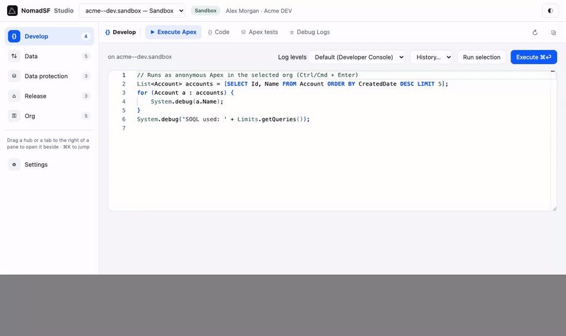
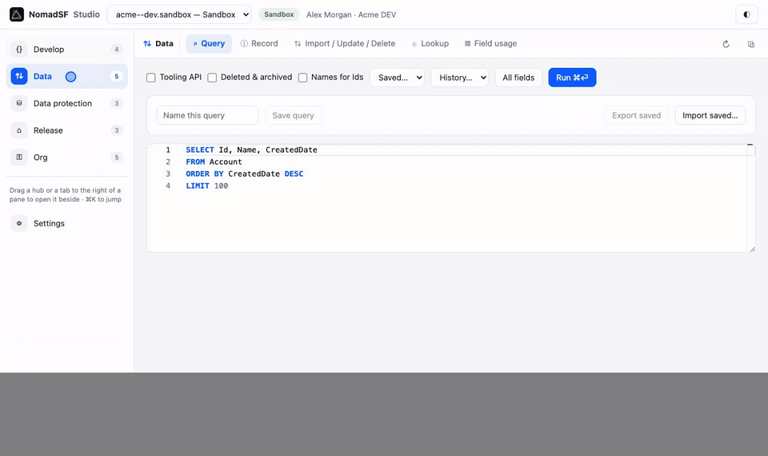
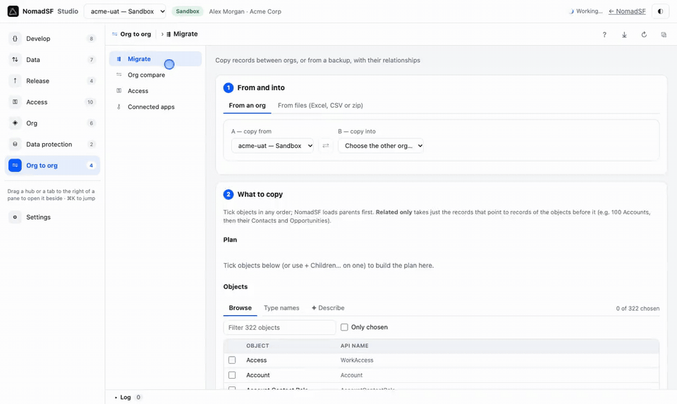

# NomadSF

**A Salesforce workbench in your browser** — Execute Apex, SOQL, code, debug logs, metadata and org compare, plus data backup, restore, migration and lifecycle jobs. It uses the Salesforce login you already have in Chrome or Edge: no CLI, nothing to install on the org, nothing sent anywhere but Salesforce.

[](https://github.com/faridmasjedi/plugin-fm/releases/latest) [](https://github.com/faridmasjedi/plugin-fm/actions/workflows/ci.yml) [](LICENSE.txt)

**[📖 Website and guide](https://faridmasjedi.github.io/plugin-fm/)** · **[⬇ Download](https://faridmasjedi.github.io/plugin-fm/#download)** · [Releases](https://github.com/faridmasjedi/plugin-fm/releases)



## What's inside

Tools are grouped into hubs, each with its own sidebar of tools. Open two or three side by side (drag a hub or a tool to the right of a pane), jump anywhere with <kbd>⌘K</kbd>, and every tab keeps its results until you reset it.

| Hub                 | Tools                                                                                                                                                                                                                                                        |
| ------------------- | ------------------------------------------------------------------------------------------------------------------------------------------------------------------------------------------------------------------------------------------------------------ |
| **Develop**         | Code (Apex, triggers, Visualforce, LWC, Aura — with dependencies and a compare with your repository) · Execute Apex · Apex tests with coverage · Debug logs · Jobs · Automation (what runs on save) · Platform events and CDC · REST Explorer                |
| **Data**            | Query (SOQL with autocomplete, saved queries, Bulk export) · Record (every field, history, and the related tree to copy into another org or save as Excel) · Import / Update / Delete from CSV or Excel · Compare with CSV · Lookup · Schema · Field usage   |
| **Release**         | Project (repository vs org) · Compare & package (branch ↔ branch, manifest, branch ↔ org, org ↔ org) · Metadata · Deployments — every package validated, deployed or quick deployed the same way, with dependent tests                                       |
| **Access**          | Users (everything a user has; snapshots) · Permission sets · Permissions (what a profile or set allows; edit) · Custom permissions · Groups & queues · Assigned users · Object access · Overview (every user's powerful permissions) · Compare · Your access |
| **Org**             | Company · Org health (security check, licenses) · Limits and storage · Connected apps and OAuth usage · Logins & audit · Activity                                                                                                                            |
| **Data protection** | Backup to your own folder (incremental, scheduled, files, encrypted) and Restore with relationships · Lifecycle jobs with approval                                                                                                                           |
| **Org to org**      | One pair of orgs, A → B, for every tool: Migrate records (from an org, a backup or a workbook; keeps every link, masks personal data) · Org compare with a deployable package · Access (users and permissions in both) · Connected apps                      |
| **✦ AI**            | Your own provider (Claude, OpenAI, Gemini, OpenRouter, Ollama, any endpoint) writes SOQL, Apex and new metadata, changes a component from a sentence, explains logs and failures, reviews code                                                               |



## Get it

| What                                 | How                                                                                                                                                                                                                                    |
| ------------------------------------ | -------------------------------------------------------------------------------------------------------------------------------------------------------------------------------------------------------------------------------------- |
| **Browser extension** (Chrome, Edge) | Download [`nomadsf-extension.zip`](https://github.com/faridmasjedi/plugin-fm/releases/latest/download/nomadsf-extension.zip), unzip, `chrome://extensions` → Developer mode → **Load unpacked**. Store listings are on the way.        |
| **VS Code**                          | Download [`nomadsf-vscode.vsix`](https://github.com/faridmasjedi/plugin-fm/releases/latest/download/nomadsf-vscode.vsix) → Extensions → **Install from VSIX…** (works on its own; uses the Salesforce CLI's logins or logs in itself). |
| **One version**                      | Each release ships the plugin, the browser extension and the VS Code extension with the same version number.                                                                                                                           |
| **Every version**                    | [GitHub Releases](https://github.com/faridmasjedi/plugin-fm/releases), or the list on the [website](https://faridmasjedi.github.io/plugin-fm/#download).                                                                               |

Then open any Salesforce page and click the NomadSF icon, or the **N** tab on the right edge (<kbd>Alt</kbd>+<kbd>Shift</kbd>+<kbd>N</kbd>). The [guide](https://faridmasjedi.github.io/plugin-fm/guide.html) walks through every hub.



## Safety and privacy

- **Your login, not ours** — the extension calls Salesforce with your browser session; it stores no password or token and has no server.
- **Every change asks first** — saving code, editing records, deploying, deleting, restoring and copying data ask you to type the org name; production orgs are shown in red.
- **Your data stays with you** — backups go to a folder you choose on your own computer, optionally encrypted (AES-256) with your passphrase.
- **AI only suggests** — it fills editors or shows text; nothing runs until you press the usual button. Keys stay in the extension and go only to the provider you chose.

Details: [nomadsf/STUDIO.md](nomadsf/STUDIO.md).

## Development

```bash
git clone https://github.com/faridmasjedi/plugin-fm
cd plugin-fm/nomadsf && yarn install && yarn build  # the Studio, the extension (apps/extension/dist) and VS Code
yarn test
```

Releasing: [RELEASING.md](RELEASING.md). Manual checks before a release: [TESTING.md](TESTING.md). The website lives in [`docs/`](docs/) (GitHub Pages).

## Contributing

Issues and pull requests are welcome. Open an issue first for larger changes; pull requests need a green CI and a review before they reach `main`. Please keep org names, record data and session ids out of issues and logs. See [CODE_OF_CONDUCT.md](CODE_OF_CONDUCT.md) and, for security problems, [SECURITY.md](SECURITY.md).

## License

Apache-2.0 — see [LICENSE.txt](LICENSE.txt). NomadSF is an independent project, not affiliated with Salesforce.
